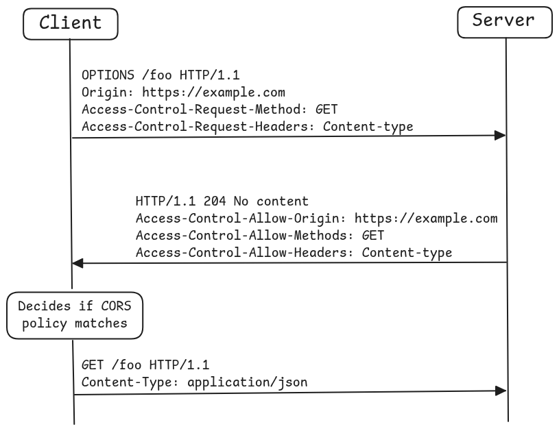

# Demystifying CORS: Preflights, Proxies, and Security Pitfalls

Cross-Origin Resource Sharing
Cross-origin communication is a must in the modern web: SPA frontends, microservices, third-party APIs.

<!-- TODO Better introduction -->
CORS as a security production setting that developers must understand when moving to production. One must understand the environment where their app is supposed to run.

CORS is a browser security mechanism used in establishing connections to servers
based on HTTP headers.
It allows the server to communicate to the browser which [origins] it should permit loading resources.

Why? which exploitation scenarios does this thwart?
Hacker want to load/embed their scripts/images, etc.

So, what defines an origin? Scheme (`https`), Domain (`example.com`), and Port (`443`). Changing any one of these creates a distinct origin.


Same-Origin Policy (SOP) ???

## How CORS Works: Preflights & Header Exchanges

Simple Requests vs. Preflighted Requests:
- **Simple Requests**: `GET`, `HEAD`, `POST` with standard content-types (`application/x-www-form-urlencoded`, `multipart/form-data`, `text/plain`) and standard headers. The browser sends the request immediately with an `Origin` header.
- **Preflighted Requests**: Triggers an automatic `OPTIONS` preflight query if using custom headers (e.g., `Authorization: Bearer ...`), `application/json` content-type, or non-simple HTTP methods (`PUT`, `DELETE`, `PATCH`).



<div align="center">
  Figure 1: CORS Request Flow Diagram
</div>


Preflight Headers Breakdown:
- **Client Request Headers**:
  - `Origin: https://app.example.com`
  - `Access-Control-Request-Method: POST`
  - `Access-Control-Request-Headers: authorization, content-type`
- **Server Response Headers**:
  - `Access-Control-Allow-Origin: https://app.example.com` (or `*` if unauthenticated)
  - `Access-Control-Allow-Methods: GET, POST, OPTIONS, PUT`
  - `Access-Control-Allow-Headers: authorization, content-type`
  - `Access-Control-Max-Age: 86400` (Caching preflight response)


## Server-Side Implementation Patterns
- **Exact Origin Matching**: Explicitly listing permitted origins (`Access-Control-Allow-Origin: https://frontend.example.com`).
- **Dynamic Subdomain / Regex Matching**: Handling dynamic preview deployments (e.g., Vercel / Netlify PR previews `myapp-*.netlify.app`) by dynamically validating incoming `Origin` headers on the backend.
- **Credentials (`Access-Control-Allow-Credentials: true`)**: Required when sending cookies or HTTP Auth headers across origins. *Crucial Rule*: Cannot be used with wildcard `Access-Control-Allow-Origin: *`.


To see more examples on CORS implementation on server: https://enable-cors.org/server.html
Nginx, Apache, Flask, ExpressJS
<!-- NOTE: Consider adding a Python/FastAPI CORS middleware snippet alongside the Nginx example below. -->

```nginx
# Sample Nginx CORS Header Configuration Block
location /api/ {
    if ($request_method = 'OPTIONS') {
        add_header 'Access-Control-Allow-Origin' '$http_origin' always;
        add_header 'Access-Control-Allow-Methods' 'GET, POST, OPTIONS, PUT, DELETE' always;
        add_header 'Access-Control-Allow-Headers' 'Authorization, Content-Type' always;
        add_header 'Access-Control-Max-Age' 86400;
        return 204;
    }
    # ... handle API upstream proxy ...
}
```

## Troubleshooting & Debugging Workflow
- **Bypassing CORS during local development**:
  - Setting up a development proxy (Vite dev server proxy, Next.js rewrites, or Nginx dev container).
  - Launching Chromium for temporary testing: `google-chrome --disable-web-security --user-data-dir="/tmp/chrome_dev"`.

- **Common Pitfalls**:
  - Returning 500 errors on `OPTIONS` preflight requests because middleware routes ignore non-GET/POST methods.
  - Missing `Access-Control-Allow-Origin` headers on HTTP error status codes (e.g., 401 Unauthorized or 500 Server Error).
  - Reverse proxy stripping CORS headers set by upstream application servers.


## Modern Trends & Security Extensions
- **Fetch Metadata Request Headers**: `Sec-Fetch-Site`, `Sec-Fetch-Mode`, `Sec-Fetch-Dest` allowing servers to defend against CSRF and cross-origin leaks without relying solely on CORS.
- **Cross-Origin Opener Policy (COOP)** & **Cross-Origin Embedder Policy (COEP)**.

## Key References & Scanners
- MDN HTTP CORS Guide: [developer.mozilla.org/en-US/docs/Web/HTTP/CORS](https://developer.mozilla.org/en-US/docs/Web/HTTP/CORS)
- HTTP Toolkit - How to Debug CORS Errors: [httptoolkit.tech/blog/how-to-debug-cors-errors/](https://httptoolkit.tech/blog/how-to-debug-cors-errors/)
- Corsair Scanner (Security Audit): [github.com/Santandersecurityresearch/corsair_scan](https://github.com/Santandersecurityresearch/corsair_scan)


https://developer.mozilla.org/en-US/docs/Web/Security/Defenses/Same-origin_policy
https://developer.mozilla.org/en-US/docs/Web/HTTP/Guides/CORS


[Enable CORS](https://enable-cors.org/): extensive documentation on CORS for clients, server, troubleshooting, 